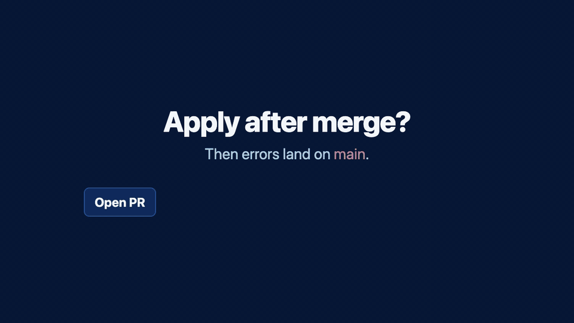

# Neptune 🌊

  
  
  
  

    
  <b>Terraform and OpenTofu pull request automation that runs inside GitHub Actions.</b>

  

**[Set up Neptune in your repository →](docs/getting-started-local-stacks.md)**

Start with a test repository. You'll need GitHub Actions, the neptbot GitHub App, Terraform or OpenTofu stacks with remote state, and an S3-compatible or GCS bucket for Neptune's stack locks. The guide walks through app installation, credentials, configuration, and the workflow. Already using Terramate? Use the [Terramate setup guide](docs/getting-started-terramate.md).

The GIF uses real screens from the public CI test [neptune-tests #311](https://github.com/devopsfactory-io/neptune-tests/pull/311). In that test, CI dispatched apply without a human approval review, and the PR was closed without merging.

- [Neptune 🌊](#neptune-)
  - [Resources](#resources)
  - [What is Neptune?](#what-is-neptune)
  - [What does it do?](#what-does-it-do)
  - [Why should you use it?](#why-should-you-use-it)

## Resources

- **Code of Conduct**: [CODE_OF_CONDUCT.md](CODE_OF_CONDUCT.md) – we adopt the CNCF Community Code of Conduct.
- **Documentation**: [docs/](docs/README.md) – Configuration, object storage, installation, usage, and development. Log level can be set via `log_level` in config or `NEPTUNE_LOG_LEVEL` (DEBUG, INFO, ERROR).
- **E2E tests**: [e2e/README.md](e2e/README.md) – Run against MinIO with `./e2e/scripts/run-terramate.sh` or `make e2e`
- **Releases**: [github.com/devopsfactory-io/neptune/releases](https://github.com/devopsfactory-io/neptune/releases)
- **Infra examples**: [examples/](examples/) – S3/GCS backend, automerge, Terramate stacks, Terragrunt.
- **neptbot**: Trigger Neptune from PR open and @-mention comments by [installing the neptbot GitHub App](https://github.com/apps/neptbot) and [adding the workflow](docs/github-app-and-lambda.md) (recommended). To self-host, see [lambda/](lambda/) and [lambda/README.md](lambda/README.md).
- **Contributing**: [CONTRIBUTING.md](CONTRIBUTING.md) – how to contribute; [docs/development.md](docs/development.md) and [AGENTS.md](AGENTS.md) for setup and AI/contributor guidance
- **Dependencies**: [Renovate](https://docs.renovatebot.com/) opens PRs for Go modules and GitHub Actions updates (see [.github/renovate.json5](.github/renovate.json5)).

## What is Neptune?

A Terraform and OpenTofu pull request automation tool inspired by [Atlantis](https://github.com/runatlantis/atlantis). Its plan and apply commands run in GitHub Actions. It supports two modes for stack management: **Terramate** (using the [Terramate](https://github.com/terramate-io/terramate) Go SDK for change detection and run order) or **local** (config or `stack.hcl` discovery with git-based change detection). Object storage (GCS or S3) holds stack locks to coordinate changes across PRs; GitHub provides PR requirements, comments, and commit statuses.

## What does it do?

Runs Terraform or OpenTofu plan and apply on pull requests with GitHub Actions. Locks stacks in object storage, checks configured PR requirements (e.g. approved, mergeable, undiverged), posts results as PR comments, and sets GitHub commit statuses for **neptune plan** and **neptune apply** (so you can require **neptune apply** in branch protection to block merge until apply succeeds).

## Why should you use it?

With the typical Terraform + GitHub Actions flow, apply often runs *after* merge. If apply fails, fixing it requires follow-up PRs. **Apply-before-merge** (plan on PR → approve → apply on the PR → merge only when apply succeeds) lets teams catch apply failures before merging. Neptune and [Atlantis](https://github.com/runatlantis/atlantis) both support this. Neptune runs plan and apply in GitHub Actions; the neptbot GitHub App triggers those workflows, and object storage holds stack locks. You can use GitHub-hosted runners with network access to your backend and providers.

- Make Terraform/OpenTofu changes visible to your whole team
- Apply approved changes in a consistent way
- Standardize workflows with configurable plan/apply steps

For a detailed comparison of the normal Terraform workflow, Neptune, and Atlantis, see [Workflow comparison](docs/workflow-comparison.md).
